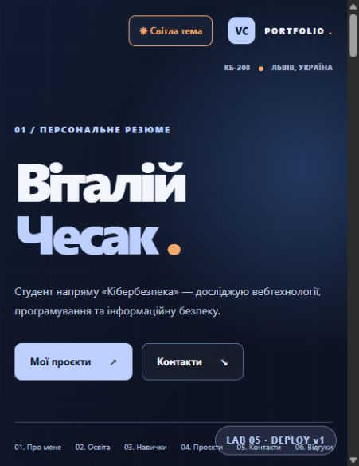
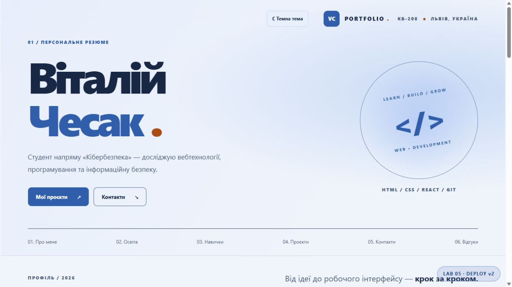
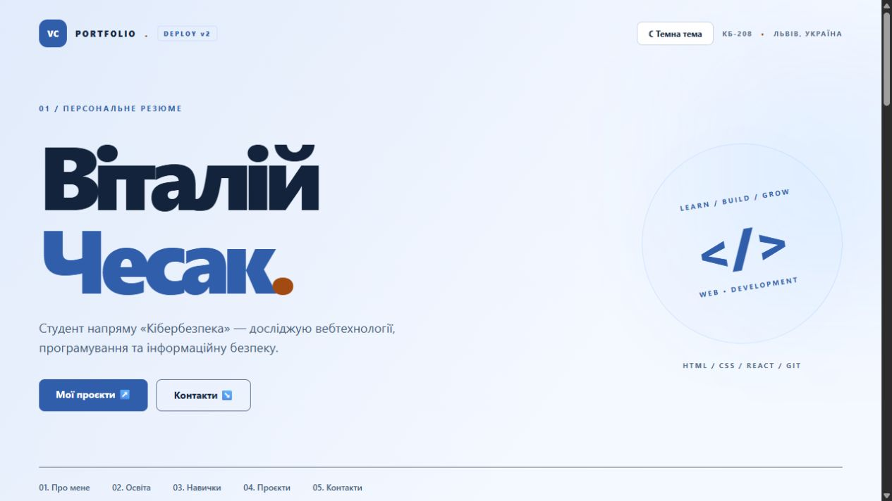
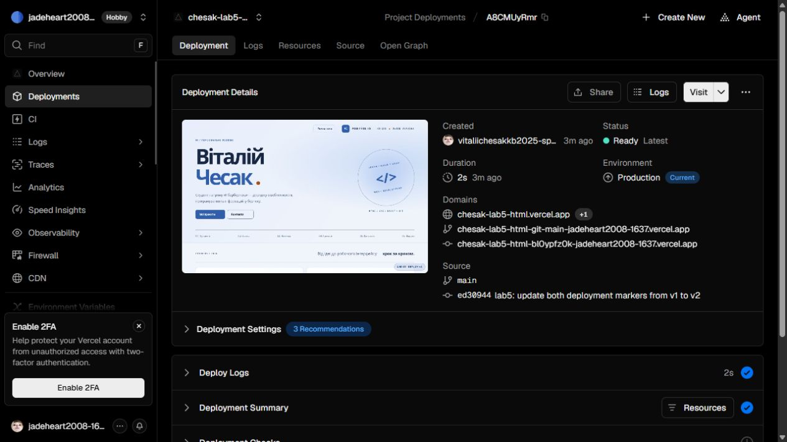
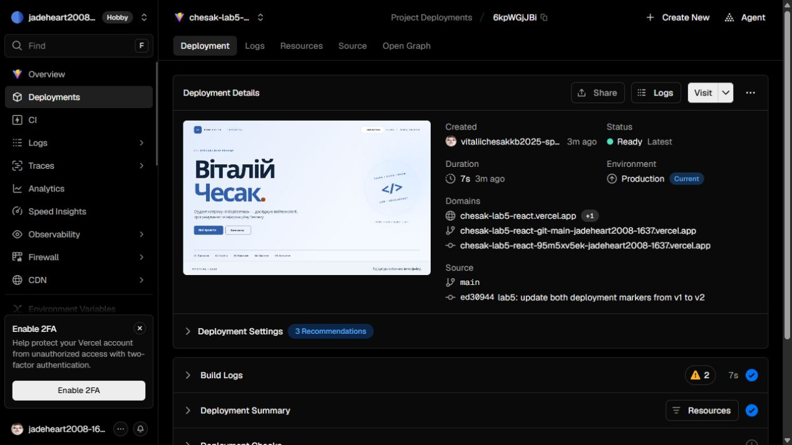
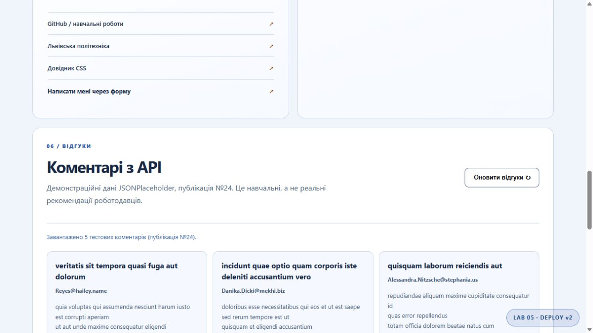
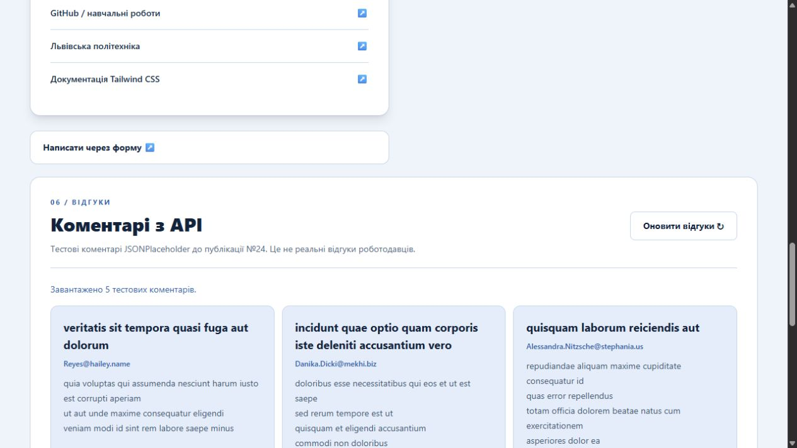
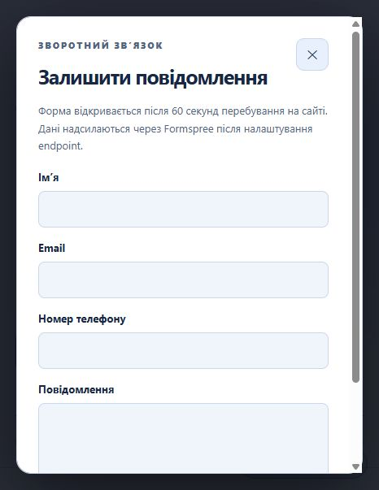

# Лабораторна робота №5 — розгортання вебсайту

**Дисципліна:** Технології вебпрограмування

**Виконав:** Чесак Віталій Володимирович, КБ-208

**Перевірено:** 12 листопада 2026 року (Europe/Kyiv).

## Мета
Опублікувати HTML/CSS/JavaScript та React/Vite портфоліо на Vercel і фактично перевірити автоматичне оновлення з GitHub.

## Налаштування
Репозиторій: [web-programming-labs](https://github.com/vitaliichesakkb2025-spec/web-programming-labs). Використано два наявні проєкти, дублікатів не створено. У Vercel Sign-in Methods перевірено GitHub-профіль vitaliichesakkb2025-spec; Vercel GitHub App бачить репозиторій, обидва проєкти прив'язано до нього.

| Параметр | HTML/CSS/JS | React/Vite |
|---|---|---|
| Проєкт | chesak-lab5-html | chesak-lab5-react |
| Production Branch | main | main |
| Root Directory | lab_5/static | lab_5/lab_2_react |
| Framework | Other | Vite |
| Build Command | порожня, без збірки | npm run build |
| Output Directory | . | dist |
| URL | [HTML](https://chesak-lab5-html.vercel.app/) | [React](https://chesak-lab5-react.vercel.app/) |

Branch Tracking обох Production-середовищ налаштовано на main. Автоматичне призначення основних доменів увімкнено.

## Автоматичне оновлення
1. До зміни обидва публічні сайти показували DEPLOY v1.
2. Після прив'язування GitHub створено окремий [коміт ed30944541cf5270b780d33ef9b3fe1b9889b43a](https://github.com/vitaliichesakkb2025-spec/web-programming-labs/commit/ed30944541cf5270b780d33ef9b3fe1b9889b43a) з маркерами DEPLOY v2 у HTML та Header/Footer React. Гілку main оновлено через GitHub API.
3. Без ручного запуску deployment Vercel автоматично створив два Production Deployments із source: git, гілкою main та SHA цього коміту.
4. Обидва деплої завершилися READY, aliasError: null. Основні домени автоматично призначено новим деплоям.
5. Після перезавантаження основних HTTPS-адрес у браузері реально видно DEPLOY v2.

| Версія | Deployment ID / докази | Стан | Тривалість |
|---|---|---|---|
| HTML | [dpl_A8CMUyRmrc7TEXjQeKuZ9RgnYaH2](https://vercel.com/jadeheart2008-1637/chesak-lab5-html/A8CMUyRmrc7TEXjQeKuZ9RgnYaH2) | Production / READY / git | близько 2 с |
| React | [dpl_6kpWGjJBiFbSGHQi2UeSaVztcQ1c](https://vercel.com/jadeheart2008-1637/chesak-lab5-react/6kpWGjJBiFbSGHQi2UeSaVztcQ1c) | Production / READY / git | близько 7 с |

Деплої створено 12.11.2026 о 10:28 за київським часом. Build Logs обох містять «Cloning github.com/vitaliichesakkb2025-spec/web-programming-labs (Branch: main, Commit: ed30944)» і «Deployment completed». React: Vite 6.4.5, 39 модулів, Vite build 1,36 с. У React-лозі є попередження npm про cache-dir та allowScripts для esbuild; збірка успішна.

## Функціональні перевірки

| Перевірка | HTML | React |
|---|---|---|
| HTTPS і DEPLOY v2 | пройдено | пройдено |
| Широкий viewport 1280 px | scrollWidth 1265 px, переповнення немає | scrollWidth 1265 px, переповнення немає |
| Вузький viewport 466 px | scrollWidth 451 px, переповнення немає | scrollWidth 451 px, переповнення немає |
| JSONPlaceholder /posts/24/comments | 5 коментарів | 5 коментарів |
| Кнопка оновлення коментарів | повторно завантажує 5 коментарів | повторно завантажує 5 коментарів |
| Світла / темна тема | data-theme перемикається | data-theme перемикається |
| localStorage | запис/читання 13 полів, відображення після reload | запис/читання 13 полів, відображення після reload |
| Автоматична форма | спостерігалося відкриття після таймера 60 с | спостерігалося відкриття після таймера 60 с |
| Закриття та ручне відкриття форми | пройдено | пройдено |
| Formspree | action=https://formspree.io/f/xzeekzba, POST | такий самий action, POST |
| Console errors під час перевірки v2 | не зафіксовано | не зафіксовано |

localStorage зберігає інформацію про браузер під успадкованим ключем kb208.lab4.system. Ручний вибір теми діє протягом поточного завантаження сторінки. Закриття автоматичної форми запам'ятовується у sessionStorage. Надсилання Formspree не виконувалося; доставку листів не перевіряли.

Локально npm ci завершився з 0 vulnerabilities, npm run build — успішно (Vite 6.4.5, 39 модулів). Усі зміни обмежено lab_5, попередні лабораторні не змінено.

## Реальні скриншоти

Початковий стан до оновлення:

HTML після автоматичного оновлення:

React після автоматичного оновлення:

Production READY, main і коміт ed30944:

Вузькі макети, фактичний viewport 466 px:

Коментарі API:

Автоматичні форми, зафіксовані під час початкової перевірки v1; логіку форми у v2 не змінювали:

## Висновок
Дві версії сайту опубліковано на наявних Vercel-проєктах. Окреме оновлення маркерів у main автоматично запустило два успішні Production Deployments; основні HTTPS-сайти показали DEPLOY v2. Функціональні перевірки виконано, реальні скриншоти збережено.
